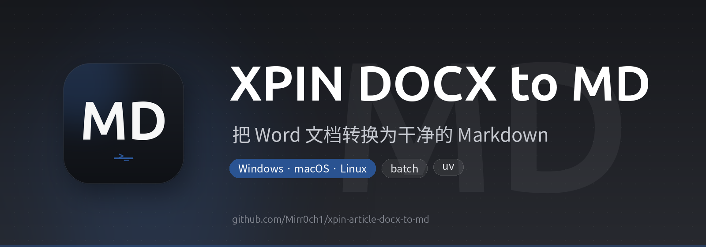

<p align="center">
  
</p>

<p align="center">
  
  
  
  
</p>

<p align="center">
  
  
  
  
</p>

<p align="center">
  
  
  
</p>

<h1 align="center">XPIN Article DOCX to MD Converter</h1>

<p align="center">
  <b>把 Word 文档转换为干净的 Markdown</b><br>
  <sub>一个按固定规则工作的 .docx → .md 转换工具，保留标题和加粗，跳过图片。</sub>
</p>

---

## ✨ 功能特点

- 🎯 **精确转换**: 严格遵循转换规则，只保留标题和加粗格式
- 🖼️ **智能跳过**: 自动跳过图片和其他不支持的内容
- 📝 **内容清理**: 自动删除文档开头的"原文"、"123"等指定内容
- 📁 **批量处理**: 支持批量转换目录中的所有Word文档
- 🔄 **跨平台**: 支持Windows、macOS、Linux
- 📊 **详细日志**: 提供详细的转换进度和结果统计
- 🧪 **测试覆盖**: 完整的单元测试确保转换质量

## 🚀 快速开始

### 📦 安装 uv（推荐）

uv 是一个极速的 Python 包管理工具，推荐用于所有平台：

```bash
# macOS/Linux
curl -LsSf https://astral.sh/uv/install.sh | sh

# Windows (PowerShell)
powershell -c "irm https://astral.sh/uv/install.ps1 | iex"
```

### 🖥️ macOS 用户

#### 方式一：使用 uv（推荐）
```bash
# 创建虚拟环境并安装依赖
uv venv
uv pip install -r requirements.txt

# 运行程序（uv run 会自动使用虚拟环境）
uv run python main.py ./documents

# 运行测试
uv run python test.py
uv run python test.py --sample
```

#### 方式二：使用 install_mac.sh
```bash
chmod +x install_mac.sh
./install_mac.sh

# 激活虚拟环境后使用
source venv/bin/activate
python main.py ./documents
deactivate

# 或直接使用虚拟环境中的 Python
./venv/bin/python main.py ./documents
```

### 🐧 Linux 用户

#### 使用 uv（推荐）
```bash
uv venv
uv pip install -r requirements.txt
uv run python main.py ./documents
```

#### 或使用安装脚本
```bash
chmod +x install.sh
./install.sh
```

### 🪟 Windows 用户

```bash
# 使用 uv（推荐）
uv venv
uv pip install -r requirements.txt
uv run python main.py ./documents

# 或直接使用 pip
pip install -r requirements.txt
python main.py ./documents
```

### 🖥️ 基本使用

```bash
# 转换当前目录下的所有Word文档
uv run python main.py ./documents

# 指定输出目录
uv run python main.py ./documents ./output

# 不递归搜索子目录
uv run python main.py ./documents --no-recursive
```

### 🎮 交互模式

```bash
# 启动交互模式（无参数时自动进入）
uv run python main.py

# 或者
uv run python main.py  # 不带参数启动交互模式
```

## 📋 转换规则

### ✅ 保留的内容
- **标题格式**: Word标题样式转换为Markdown标题 (`#`, `##`, `###` 等)
- **加粗文本**: Word加粗文本转换为Markdown加粗 (`**文本**`)
- **正文内容**: 普通段落文本

### ❌ 跳过的内容
- **图片**: 所有图片内容完全跳过，不保留也不显示
- **表格**: 根据配置跳过表格内容
- **页眉页脚**: 自动跳过
- **其他格式**: 忽略斜体、下划线等其他格式

### 🗑️ 删除的内容
文档开头删除以下模式：
- `## 原文` (整个标题行)
- `123` (独立行)
- `123123` (独立行)

## 🛠️ 详细使用方法

### 命令行参数

```bash
uv run python main.py [输入目录] [输出目录] [选项]

参数:
  输入目录              包含要转换的Word文档的目录
  输出目录              可选的输出目录（默认为input_dir的父目录/markdown_files）

选项:
  --no-recursive       不递归搜索子目录
  --dry-run           预览模式，显示将要转换的文件但不实际转换
  --list-files        列出将要转换的文件
  --verbose           显示详细输出
  --version           显示版本信息
  -h, --help          显示帮助信息
```

### 使用示例

```bash
# 1. 基本转换
uv run python main.py ./my_documents

# 2. 指定输出目录
uv run python main.py ./my_documents ./my_output

# 3. 不递归搜索子目录
uv run python main.py ./my_documents --no-recursive

# 4. 预览模式（不实际转换）
uv run python main.py ./my_documents --dry-run

# 5. 列出将要转换的文件
uv run python main.py ./my_documents --list-files

# 6. 详细输出模式
uv run python main.py ./my_documents --verbose
```

### 交互模式使用

启动程序后，按提示输入：
1. 输入包含Word文档的目录路径
2. 输入输出目录（可选，直接回车使用默认）
3. 确认开始转换

输入 `quit` 或 `exit` 可退出交互模式。

## 📁 项目结构

```
xpin-article-docx-to-md/
├── main.py              # 主程序入口
├── converter.py         # 核心转换器
├── config.py            # 配置文件
├── utils.py             # 工具函数
├── test.py              # 测试模块
├── requirements.txt     # 依赖列表
├── install.sh           # Linux/macOS 安装脚本
├── install_mac.sh       # macOS 专用安装脚本（使用虚拟环境）
├── README.md           # 说明文档
├── QUICKSTART.md       # 快速开始指南
└── 示例测试文件/
    └── sample/         # 示例测试目录
```


### 创建示例测试文件

```bash
# 使用 uv（推荐）
uv run python test.py --sample

# 或激活虚拟环境后使用
source venv/bin/activate
python test.py --sample
deactivate
```

### 运行所有测试

```bash
# 使用 uv（推荐）
uv run python test.py --all

# 或激活虚拟环境后使用
source venv/bin/activate
python test.py --all
deactivate
```

## 📝 输出格式

### 输入示例 (Word文档)
```
## 原文

# 华为Mate 80系列发布会

这是一段**重要内容**，需要特别关注。

这是普通段落内容。

123

更多详情...
```

### 输出示例 (Markdown)
```
# 华为Mate 80系列发布会

这是一段**重要内容**，需要特别关注。

这是普通段落内容。

更多详情...
```

## ⚙️ 配置说明

可以通过修改 `config.py` 文件来自定义行为：

```python
class Config:
    # 支持的文件扩展名
    SUPPORTED_EXTENSIONS = {'.docx', '.doc'}
    
    # 需要删除的开头内容模式
    REMOVE_PATTERNS = [
        r'^## 原文\s*$',
        r'^123\s*$',
        r'^123123\s*$',
    ]
    
    # 保留的文本格式
    PRESERVED_FORMATS = {
        'bold': '**',
        'heading': '#',
    }
```

## 🔧 依赖包说明

- `python-docx==1.1.0`: Word文档解析和处理
- `markdown==3.5.2`: Markdown格式支持
- `pathlib2==2.3.7`: 跨平台路径处理
- `colorama==0.4.6`: 彩色终端输出

## 🐛 故障排除

### 常见问题

1. **ImportError: No module named 'docx'**
   ```bash
   uv pip install python-docx
   ```

2. **权限错误**
   - 确保对输入和输出目录有读写权限
   - 在Linux/macOS上可能需要使用 `sudo`

3. **文件格式不支持**
   - 确保文件是 `.docx` 或 `.doc` 格式
   - 检查文件是否损坏

4. **转换失败**
   - 检查Word文档是否有密码保护
   - 确认文档格式正确

5. **macOS "externally-managed-environment" 错误**
   - 使用 uv 管理（推荐）
   - 或使用 `install_mac.sh` 脚本安装
   - 或手动创建虚拟环境：
     ```bash
     python3 -m venv venv
     source venv/bin/activate
     uv pip install -r requirements.txt
     ```

### 调试模式

使用 `--verbose` 参数获取详细的错误信息：

```bash
# 使用 uv（推荐）
uv run python main.py ./documents --verbose

# 或使用虚拟环境
./venv/bin/python main.py ./documents --verbose
```

## 📄 许可证

本项目采用 MIT 许可证。

## 🤝 贡献

欢迎提交Issue和Pull Request来改进这个工具！

## 📞 支持

如有问题或建议，请提交Issue。

---

**注意**: 此工具专门为特定转换规则设计，如果需要修改转换逻辑，请参考代码注释或联系开发者。
